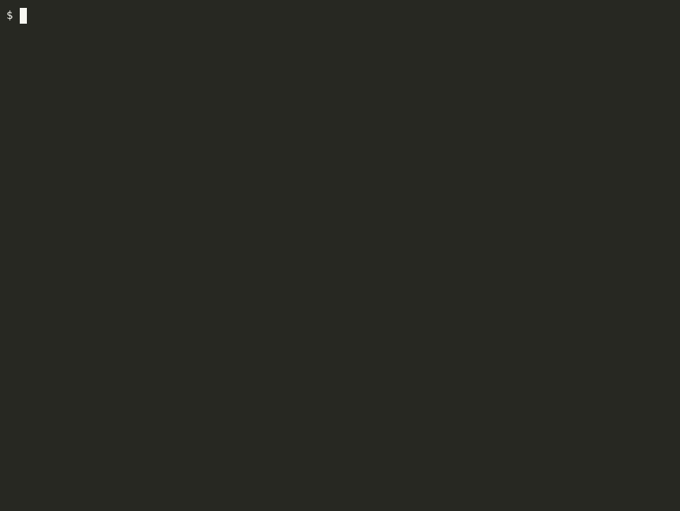

# 👻 css-ghost

[](https://www.npmjs.com/package/css-ghost)
[](https://www.npmjs.com/package/css-ghost)
[](https://github.com/rolandjlevy/css-ghost/blob/main/LICENSE)

Find and remove unused CSS selectors and orphaned CSS custom properties: styles defined in your source but never referenced in your components. Works with React, Vue, Svelte, SCSS and CSS Modules. No build step and no config required.



## Quick start

```bash
npx css-ghost ./src
```

Or install globally with `npm install -g css-ghost`. Run `css-ghost` with no arguments for an interactive folder picker. Each orphan is printed with its line number and the CSS itself, and a Markdown report is written to `orphan-report.md`.

## What it detects

- **Style files:** `.css`, `.module.css`, `.scss`, `.sass`, `.less`; JS/TS style objects (`StyleSheet.create`, MUI `makeStyles`); vanilla-extract `.css.ts` / `.css.js`
- **Usages:** `className="foo"`, `styles.foo`, `styles['foo']`, ternaries, `cx()` / `clsx()` / `classnames()` (strings, objects, arrays), MUI `classes.foo`, vanilla-extract imports, Vue `:class`, Svelte `class:name`
- **Dynamic classes:** `styles[variable]` and `${}` template literals can't be resolved statically, so the file is flagged with ⚠️ instead of producing false positives
- **CSS variables:** `--my-token` defined but never used via `var(--my-token)`

## Options

```bash
css-ghost [directory] [directory2] ... [options]
```

| Flag              | Description                                              |
| ----------------- | -------------------------------------------------------- |
| `--output <file>` | Report path (default `orphan-report.md`)                 |
| `--delete`        | Delete orphaned selectors from source (asks first)       |
| `--yes`           | Skip the `--delete` confirmation                         |
| `--strict`        | Exit with code 1 if any orphans are found (CI)           |
| `--ghost-trail`   | Show the last git commit that touched each orphan        |
| `--install-hook`  | Install a pre-commit hook that blocks commits with orphans |
| `--ai`            | Append an AI summary (run `--setup` once with a free [OpenRouter](https://openrouter.ai/keys) key) |
| `--init`          | Create or update `css-ghost.config.js` interactively     |

> Commit or stash before using `--delete`. There is no undo.

## Config file

For team projects, create `css-ghost.config.js` (or `.css-ghostrc.json`) in your project root. `css-ghost --init` generates it. CLI flags always override config values.

```js
export default {
  dirs: ['./src'],
  output: 'reports/orphan-report.md',
  ignore: ['legacy', 'vendor'], // added to the built-in ignore list
  strict: true,
};
```

## Use it from an AI assistant

[`css-ghost-mcp`](mcp/README.md) is a read-only MCP server that lets Claude, Cursor and other assistants find unused CSS in your project, with git history for each orphan. See `mcp/README.md` for setup.

## Programmatic API

```js
import { scan, generateReport } from 'css-ghost';

const results = scan(['./src'], { ignore: ['legacy'] });
const { totalAllOrphans } = generateReport(results, 'orphan-report.md');

if (totalAllOrphans > 0) process.exit(1);
```

TypeScript types are included.

## How is this different from PurgeCSS?

[PurgeCSS](https://www.npmjs.com/package/purgecss) is a build-time tool that strips unused CSS from production bundles. css-ghost audits the CSS you write by hand, straight from source.

|                             | PurgeCSS                      | css-ghost        |
| --------------------------- | ----------------------------- | ---------------- |
| Works on source files       | ❌ Build output only          | ✅               |
| Zero config, no build step  | ❌ Requires webpack / PostCSS | ✅               |
| CSS custom property orphans | ❌                            | ✅               |
| Deletes dead code for you   | ❌                            | ✅               |
| Safe with dynamic classes   | ❌ Silently removes them      | ✅ Flags with ⚠️ |

The two are complementary: PurgeCSS for trimming framework output at build time, css-ghost for auditing your own CSS during development.

## More

Full guide (config reference, ghost trail, pre-commit hook, CI, deleting, API details): [docs/guide.md](https://github.com/rolandjlevy/css-ghost/blob/main/docs/guide.md)

One runtime dependency ([`picocolors`](https://github.com/alexeyraspopov/picocolors)). [MIT](https://github.com/rolandjlevy/css-ghost/blob/main/LICENSE)
